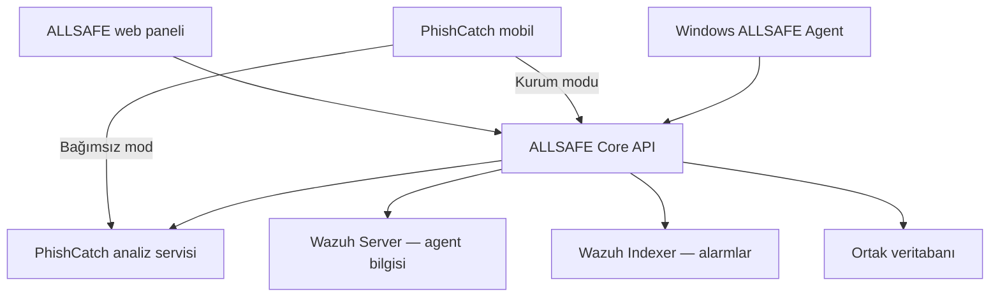

# ALLSAFE mimarisi

ALLSAFE, şirketin güvenlik bulgularını ve cihazlarını ortak bir panelde birleştiren modüler bir platformdur. İlk teslimin temeli merkezi API ve cihaz kayıt akışıdır. Geliştirme sırası [yol haritasında](roadmap.md), başlangıç kararı [ADR 0001'de](decisions/0001-architecture.md) yer alır.

## Bileşenler

| Bileşen | Sorumluluğu |
| --- | --- |
| Core API | Cihaz kimliği, kayıt, oturum/yetki, olaylar ve bağlantıların ortak veri modeli |
| ALLSAFE Agent | Windows cihaz envanteri, bağlantı bildirimi ve ileride izin verilen yönetim işleri |
| Wazuh bağlantısı | Güvenlik olayları, agent durumu ve güvenlik bulguları |
| PhishCatch | URL/QR analizi, mobil sonuç, tarama geçmişi ve doğrulanmış eğitim verisi |
| Web paneli | Ortak cihaz, olay ve tarama ekranları; işlemlerin durumunu ve veri güncelliğini gösterme |

ManageEngine entegrasyonu kapsamda değildir. Wazuh Agent ve ALLSAFE Agent farklı sorumluluklara sahiptir; iki kaynağın kayıtları ortak ALLSAFE cihaz kimliğiyle eşleştirilir. IP adresi tek başına cihaz kimliği değildir.

## İlk milestone: platform temeli

- FastAPI ile merkezi API.
- SQLAlchemy veri katmanı; yerel geliştirmede SQLite, sonraki dağıtım aşamasında PostgreSQL.
- Alembic ile sürümlenmiş veritabanı migration'ları.
- Süreli ve tek kullanımlık kayıt daveti oluşturma.
- Davetle cihaz kaydı, cihaz kimliği ve ayrı cihaz erişim token'ı üretme.
- Kimliği doğrulanan cihazdan heartbeat alma ve yönetici için cihaz listeleme.
- Kayıt ve kimlik doğrulama sınırlarını doğrulayan otomatik testler.

Bu milestone gerçek Windows servisini, web arayüzünü veya uzaktan komut çalıştırmayı içermez. API akışı yerel istemci veya testlerle doğrulanır.

## Cihaz kayıt ve token akışı

1. Yönetici yetkili API üzerinden kayıt daveti oluşturur; token sadece bu cevapta gösterilir.
2. Cihaz daveti kayıt isteğinde sunar. Sunucu token'ı, geçerlilik süresini ve daha önce kullanılıp kullanılmadığını denetler.
3. Davetin tüketilmesi ile cihaz kaydı aynı veritabanı işlemi içinde tamamlanır; tekrar kullanım reddedilir.
4. Sunucu ayrı bir cihaz token'ı verir. Heartbeat bu token ile doğrulanır; bir cihaz başka cihaz adına yazamaz.
5. Yönetici cihazları sunucunun kayıt ve son bağlantı zamanlarıyla listeler. Bağlantı durumu son heartbeat'ten hesaplanır; saat bilgisi UTC tutulur.

Rastgele token'ların yalnızca özetleri veritabanında saklanır. Token'lar URL parametrelerinde, günlüklerde veya kaynak kodda yer almaz. Geliştirme dışındaki iletişim TLS gerektirir. Cihaz erişim iptali ve token rotasyonu uygulanmıştır; yeni anahtarın cihaza güvenli kurulması ayrı kabul adımıdır.

Başlangıçtaki yönetici erişim token'ı yalnızca yerel geliştirme ve test içindir. Ortam değişkeninden alınır; istemci uygulamasına gömülmez. Bu mekanizma üretim yetkilendirmesi sayılmaz. Üretimden önce OIDC tabanlı kullanıcı girişi, RBAC, işlem kaydı ve güvenli cihaz kimlik yaşam döngüsü tamamlanmalıdır.

## PhishCatch entegrasyonu

Upstream [PhishCatch](https://github.com/KeremDuz/PhishCatch), `packages/phishcatch` altında sabitlenmiş bir Git submodule olarak korunur. ALLSAFE değişiklikleri önce bağlantı katmanında yapılır; upstream sürüm yükseltmesi ayrı PR ve uyumluluk kontrolü gerektirir.

Mobil QR/URL taraması için hedef akış:

1. Çalışan kurumsal hesabıyla tarama yapar.
2. Analiz sonucu, tarama kimliği, kullanıcı/cihaz ilişkisi, kaynak ve tarayıcı durumu merkezi kayda alınır.
3. Panel, model tahminini ve kanıtları gösterir. Eksik analiz ayrı bir belirsiz durumdur.
4. Yetkili inceleyici bağımsız bir doğrulanmış etiket verir: temiz, zararlı veya kararsız.
5. Yalnızca onaylı örnekler eğitim havuzuna alınır. Kullanıcı kimlikleri ve URL'deki hassas değerler eğitim verisine taşınmaz.
6. Aday model ayrı test verisinde değerlendirilir; model sürümü ve veri sürümü kaydedilerek kontrollü yayımlanır.

Model tahmini eğitim etiketi değildir. Her tarama canlı modeli otomatik güncellemez. Mobil tarama tek başına çalışanın bilgisayarının ele geçirildiği anlamına gelmez.

## Sonraki aşamaların sınırları

Uzaktan yönetim işleri eklendiğinde izin verilen komut listesi, hedef cihaz yetkisi, iş kimliği, tekrar çalıştırma kontrolü ve doğrulanmış sonuç gerekir. İsteğin kabul edilmesi ile cihazdaki işlemin tamamlanması ayrı durumlar olacaktır. Patch management, uzaktan masaüstü, DLP, firewall ve DNS firewall ilk teslimin dışında kalır.

Güncel PhishCatch servis sınırı ve ayrı eğitim onayı [ADR 0005](decisions/0005-phishcatch-boundary.md) ve [kurulum belgesinde](phishcatch.md) açıklanır. Wazuh'un ayrı okuma bağlantıları, bilinmeyen/kısmi durumları ve Server origin'ine bağlı cihaz eşleştirmesi [ADR 0006](decisions/0006-wazuh-boundary.md) ve [bağlantı belgesinde](wazuh.md) açıklanır.
