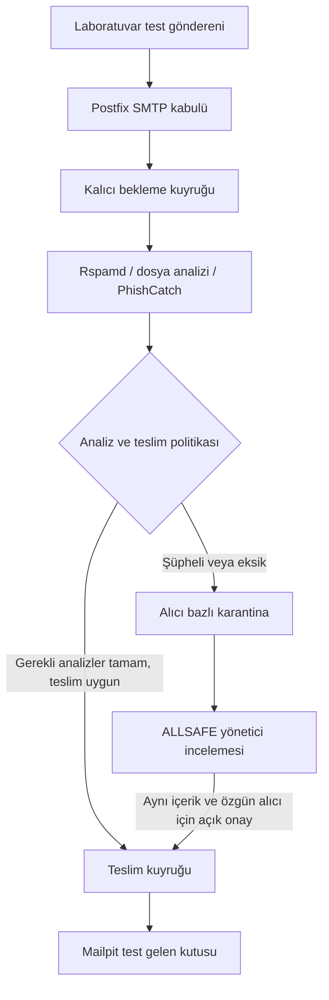

# E-posta güvenlik geçidi planı

**Durum: Planlandı; henüz uygulanmadı.** Bu belge sonraki geliştirme için alınan kapsam kararını kaydeder. ALLSAFE şu anda SMTP geçidi kurmaz, gelen postaları teslim öncesi durdurmaz ve PDF/ZIP/MP4 eklerini zararlı dosya taramasından geçirmez. Buradaki akışın kabul testi yapılmadı; gerçek DNS/MX, posta sağlayıcısı veya çalışan posta kutusunda değişiklik yapılmadı.

## Hedef davranış

Kuruma gelen e-postalar önce ALLSAFE'in yönettiği güvenlik geçidinden geçer. Gerekli incelemeleri tamamlanan ve teslim politikasını karşılayan mesaj otomatik teslim edilir. Şüpheli veya incelemesi eksik mesaj karantinada bekler; yetkili yönetici bulguları inceledikten sonra yalnız özgün alıcılara teslim edilmesine karar verebilir. Kesinti, zaman aşımı veya desteklenmeyen ek temiz sonuç sayılmaz.

Bu, tek kurumluk bitirme projesinin ayrı bir sonraki modülüdür. Mevcut [PhishCatch bağlantısı](phishcatch.md), [Windows ajanı](windows-agent.md) ve [Wazuh bağlantısı](wazuh.md) kendi sorumluluklarını korur. PhishCatch URL/HTML modelleri, e-posta ekleri için malware modeli olarak kullanılmaz; mesajdaki URL'lerin phishing incelemesinde yeniden kullanılır.

## Önerilen bileşenler

| Bileşen | Planlanan sorumluluk |
| --- | --- |
| Postfix | SMTP kabulü, kalıcı posta kuyruğu, izinli alıcı/domain yönlendirmesi ve teslim denemeleri |
| Rspamd | Spam ve e-posta kimlik doğrulama sinyalleri; teslim kararına gerekçe sağlayan kurallar |
| ClamAV ve sınırlı dosya analiz worker'ı | Antivirüs imzaları, gerçek dosya türü, hash ve izin verilen statik ek kontrolleri |
| PhishCatch servisi | Gövdeden ve desteklenen içerikten çıkarılan URL'lerin mevcut phishing akışıyla analizi |
| ALLSAFE EmailSecurity / FileAnalysis | İş/sonuç metaverisi, karar politikası, alıcı bazlı karantina, insan incelemesi ve teslim onayı |
| İzole içerik deposu | Özgün mesaj ve eklerin, hash ve saklama süresiyle sınırlanmış erişimi |
| Mailpit | İlk laboratuvarın gerçek kişiye teslim yapmayan test gelen kutusu |

İlk aşamada kendi SMTP sunucumuzu veya genel dosya çalıştırma servisimizi yazmak hedeflenmez. Panel/API kontrol ve incelemeyi, MTA kuyruk ve teslimi, ayrı worker'lar analizi üstlenir.

## Kuyruk ve karar sınırları

- Mesaj kalıcı kuyruğa yazılmadan başarılı SMTP kabulü (`250`) verilmez. Disk doluysa veya kalıcı depolama kullanılamıyorsa mesaj başarıyla alınmış gibi gösterilmez. Kabul edilmiş mesaj, API yeniden başlatılınca kaybolmamalıdır.
- Analiz bitmeden arka posta sunucusuna teslim yolu açılmaz. Postfix'in bekleme/analiz ve teslim yolları ayrı yapılandırılır; scanner'ı atlayan varsayılan bir çıkış bırakılmaz.
- Panel kapalı olması sağlıklı MTA kuyruk kabulünü gereksiz yere durdurmamalıdır. Worker, veritabanı veya karar politikası kullanılamıyorsa mesaj bekler/yeniden denenir; kesinti otomatik teslim izni üretmez. Yönetici ekranının çalışmaması karantinayı serbest bırakmaz.
- Antivirüsün bulgu üretmemesi tek başına bütün mesajın temiz olduğu anlamına gelmez. Gerekli analizlerin durumu ve politika sürümü saklanır. Parolalı ZIP, desteklenmeyen dosya veya yarım analiz açıkça belirsiz kalır.
- `received`, `queued`, `scanning`, `quarantined`, `release_authorized`, `delivery_queued`, `delivered` ve hata/belirsiz sonuçlar ayrı izlenir. Onay, teslim kuyruğuna alınma ve hedef sunucunun kabulü tek bir başarı durumu yapılmaz.

## E-posta kimliği ve sağlayıcı bağlantısı

Özgün mesaj baytları, içerik hash'i, gerçek SMTP bağlantı bağlamı ve zarf alıcıları korunur. Görünen `From`/`To` başlıkları SMTP zarfının yerine geçmez. Özellikle SPF için alım noktasındaki gerçek bağlantı bilgisi gerekir; sonradan yüklenen `.eml` dosyasında bütün geçmiş doğrulamanın tekrar üretilebildiği iddia edilmez. SPF/DKIM/DMARC sonuçları, ek güvenliğinden ayrı gösterilir. Başarılı kimlik doğrulama zararlı ek bulunmadığını kanıtlamaz.

İnternetten gelen `Authentication-Results` veya `X-ALLSAFE-*` başlıkları güven damgası sayılmaz. Kendi alım noktamızın ya da açıkça güvenilen sağlayıcı bağlantısının sonuçları ayrıştırılır. İmzalı içerik gereksiz yere değiştirilmez; yeniden gönderimde özgün kanıt kaybolmamalıdır.

Gerçek kullanımda MX ve sağlayıcının gelen posta connector kuralları birlikte tasarlanır. Arka posta sunucusu/sağlayıcı, doğrudan internetten gelen teslimle geçidi atlamaya izin vermemelidir. İzinli domain ve alıcılar önceden tanımlanır; rastgele dış alıcıya aktarım yapan açık relay kurulmaz. Microsoft 365 veya başka sağlayıcıya özgü connector ve kimlik doğrulama ayarları, sağlayıcı seçildikten sonra ayrı kabul edilir. Bu belge gerçek MX/connector değişikliği yetkisi veya uygulanmış bağlantı anlamına gelmez.

Temiz mesajın veya yönetici tarafından serbest bırakılan mesajın dahili yeniden gönderimi yalnız doğrulanmış iç yol üzerinden yapılır. Dışarıdan eklenebilen bir başlıkla tarama atlanmaz; tekrar dolaşımı önleyen sınırlı işlem kimliği/döngü kontrolü bulunur.

## Karantina ve insan kararı

Karantina mesaj ve **alıcı bazında** tutulur. Aynı mesajdaki bir alıcı için teslim onayı, diğer bekleyen alıcıları otomatik serbest bırakmaz. ALLSAFE'in ürettiği iç mesaj kimliği esas alınır; gönderenin seçtiği `Message-ID` tek başına kimlik veya tekrar teslim anahtarı olmaz.

Serbest bırakma işlemi, yetkili insan oturumu, CSRF koruması, gerekçe, sabit özgün alıcı ve aynı içerik hash'ine bağlanır. Panelden yeni dış alıcı veya değiştirilmiş ek ekleyerek teslim onayı verilemez. Tekrar tıklama ve worker yeniden başlatması için atomik onay kaydı, idempotency anahtarı ve MTA teslim kuyruğu kimliği gerekir. SMTP'nin son kabul yanıtı kaybolursa sonuç belirsiz olabilir; mutlak tek teslim garantisi verilmeden önce bu senaryo ayrıca çözülür ve test edilir.

İnceleme etiketi, yeniden tarama, teslim izni, silme ve eğitim onayı ayrı işlemlerdir. Bir yöneticinin postayı teslim etmesi otomatik model eğitim etiketi veya canlı model yükseltmesi değildir. Yeni dosya modeli ancak ayrı veri, doğrulama ve promotion kararıyla eklenir; mevcut URL eğitim havuzuna ek dosyalar olduğu gibi gönderilmez.

Veritabanında karar/işlem metaverisi tutulur; mesaj/ek içeriği izole depoda kalır. Erişim, saklama süresi ve silme davranışı tasarlanır. Panel ham HTML'yi etkin içerik olarak açmaz, uzak görselleri kendiliğinden indirmez ve eki tarayıcıda veya sunucu üzerinde otomatik çalıştırmaz. İlgisiz kullanıcılar karantina içeriğine erişemez.

## Ek analizi ve ilk kaynak sınırı

İlk kapsam `.eml`, URL, PDF ve kontrollü ZIP incelemesidir. Dosya uzantısı yerine içerik türü de kontrol edilir. Dosya boyutu, arşiv derinliği, açılan toplam veri, dosya sayısı, süre ve eşzamanlı iş sayısı sınırlanır. ZIP üyelerinin yol aşımı ve açılım saldırıları test edilir. MP4 için ilk aşamada yalnız sınırlı statik tür/hash/antivirüs incelemesi düşünülebilir; kapsamlı video exploit analizi varmış gibi sunulmaz.

8 GB RAM'li laboratuvar için başlangıç tek eşzamanlı analiz işi ve ölçülmüş sınırlar olarak planlanır. Bu kapasite kabulü değildir; büyük URL modeli, Wazuh ve diğer servislerle birlikte bellek/CPU/disk ölçümü gerekir. Model eğitimi bu akışta otomatik çalıştırılmaz. Şüpheli dosya ana API, Windows ajanı veya sunucunun kendi masaüstünde açılıp çalıştırılmaz. Dinamik davranış analizi daha sonra, ayrı ve sıfırlanabilir izole VM/makinede tasarlanır; ilk mail geçidi demosuna dahil değildir.

## İlk uygulanacak test akışı

1. Gerçek domain/MX yerine izole laboratuvar SMTP yolu ve Mailpit hazırlayın. Yalnız sahte test gönderenleri ve test alıcıları tanımlayın; gerçek çalışan postası kullanmayın.
2. Güvenli test mesajı kalıcı kuyruğa girsin. Gerekli analizlerin tamamlandığı kaydedilsin; mesaj yalnız bir kez Mailpit'e teslim edilsin. Panelde kabul, analiz ve teslim adımları ayrı görülsün.
3. Zararlı çalıştırmadan hazırlanmış bir kural test mesajı şüpheli olarak karantinaya alınsın. Mailpit'e ulaşmadığını doğrulayın. Yetkili yönetici aynı içerik ve özgün alıcı için onay verince teslim edilsin.
4. İki alıcılı bir mesajda yalnız bir alıcıyı serbest bırakın. İkinci alıcı beklesin. Tekrar onay, yanlış alıcı ve yetkisiz hesap denemeleri ikinci/başka teslim üretmesin.
5. Scanner, PhishCatch, panel ve veritabanı kesintilerini ayrı deneyin. Eksik analiz temiz görünmesin; kalıcı kuyruktaki mesaj süreç yeniden başlatıldığında korunsun. Depolama dolması ve tarama zaman aşımı kontrollü biçimde raporlansın.
6. Doğrudan arka sunucuya teslim, sahte doğrulama başlığı, açık relay, dahili yeniden gönderim döngüsü ve belirsiz SMTP son yanıtı senaryolarını doğrulayın. Bunlar geçmeden gerçek sağlayıcı/domain pilotuna geçmeyin.

Uygulamaya başlanırken Postfix/analiz entegrasyonu, karantina veri modeli ve teslim durumları ayrıca gözden geçirilir. Bu planın kaydedilmesi çalışan bir mail gateway, kurumsal koruma veya üretim hazırlığı iddiası değildir.
