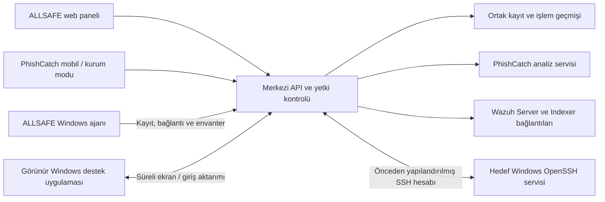

# ALLSAFE — proje anlatımı ve gösterim rehberi

Bu belge, 16 Ekim 2026 tarihindeki kod ve yerel doğrulama durumunu anlatır. ALLSAFE tek kurum için geliştirilen bir bitirme projesi prototipidir. Otomatik test, yerel servis denemesi ve gerçek cihaz kabulü ayrı kanıtlardır; aşağıdaki anlatım bu ayrımı korur.

## 45–60 saniyelik anlatım

> ALLSAFE, bir şirketin güvenlik bulgularını ve cihazlarını ortak bir yönetim panelinde bir araya getiren modüler projemiz. Çalışan PhishCatch mobil uygulamasında bir QR kod veya bağlantı taradığında, kurum modundaki sonuç merkezi panele geliyor. Yetkili kişi model tahminini inceleyebiliyor; doğrulanmış etiket ve ayrı eğitim onayıyla kullanılabilecek örnekler oluşturabiliyor. Kendi Windows ajanımız cihaz kaydı, bağlantı durumu ve temel envanteri sağlıyor. Uzaktan masaüstü desteğimiz ve önceden yapılandırılmış Windows hesabıyla yönetici terminalimiz de var. Wazuh için güvenlik alarmı ve cihaz durumu bağlantısını hazırladık; canlı sunucu kabulü henüz yapılmadı. Projenin katkısı, bu işlerin kimlik, yetki, cihaz ilişkisi ve işlem geçmişini aynı yerde toplamak. Şu anda gösterilebilir bir laboratuvar prototipimiz var; gerçek kurum kullanımı için cihaz ve entegrasyon kabulü sürüyor.

## Hangi problemi çözüyoruz?

Bir kurumda bağlantı analizi, güvenlik alarmları ve bilgisayar bilgileri farklı uygulamalarda bulunabilir. Yönetici, aynı olayı anlamak için ekranlar arasında geçiş yapar; farklı kimlikleri ve erişim kurallarını takip eder. ALLSAFE ortak kullanıcı, cihaz ve işlem kaydı üzerinden bu dağınıklığı azaltmayı hedefler.

Örneğin bir çalışanın taradığı şüpheli bağlantı merkezi listede incelenebilir. Aynı panelde şirket bilgisayarlarının bağlantı durumu görülebilir; hazırlanmış cihazda destek veya yönetim oturumu açılabilir. Wazuh bağlantısı tamamlandığında, açıkça eşleştirilmiş bilgisayarın güvenlik bulguları da ilişkilendirilebilir. Mobil URL taraması tek başına o çalışanın Windows bilgisayarının ele geçirildiğini kanıtlamaz.

CrowdStrike, Trend Micro veya Trellix ilk fikirdeki ürün örnekleridir; mevcut teslimde bu ürünlere çalışan bağlayıcılar bulunmaz. Bugünkü kapsam PhishCatch, Wazuh bağlantısı, kendi Windows ajanımız ve ortak yönetim çekirdeğidir.

## Parçalar nasıl birlikte çalışıyor?

Panel, işlemi yapan insanın yetkisini kontrol eden API'ye bağlanır. PhishCatch analizini ayrı servis yürütür. Windows ajanı kendi cihaz kimliğiyle bildirim gönderir. Wazuh Agent ile ALLSAFE Agent ayrı yazılımlardır; kayıtları yönetici açıkça eşleştirir. RDP seçeneğinde panel bir bağlantı profili indirir; asıl oturumu yerel Windows RDP istemcisi yönetir.

| Katman | Kullanılan teknoloji | Görevi |
| --- | --- | --- |
| Merkezi servis | Python, FastAPI | Kimlik, yetki, cihazlar, taramalar ve entegrasyon API'leri |
| Veri katmanı | SQLAlchemy, Alembic, yerel SQLite | Kalıcı kayıt ve sürümlenmiş veritabanı şeması |
| Yönetim paneli | React, TypeScript, Vite | Cihaz, tarama, kullanıcı ve bağlantı ekranları |
| Windows ajanı ve destek uygulaması | C#, .NET 10, WinForms | Cihaz bildirimi ve görünür masaüstü paylaşımı |
| PhishCatch | Python, scikit-learn; Flutter/Dart mobil uygulama | URL/HTML analizi ve mobil QR/URL kullanımı |
| Yönetici terminali | OpenSSH, AsyncSSH, tarayıcı terminali | Hazırlanmış hedefte etkileşimli komut oturumu |

Windows ajanı C# ile yazılmıştır. Go'ya geçiş yapılmadı. Windows'a özgü servis, kimlik koruması ve masaüstü işlemleri mevcut C# uygulamasında bulunur. PostgreSQL ve gerçek kurum kimlik sağlayıcısı ayrı kabul gerektirir.

## Bugün ne hazır, ne bekliyor?

| Alan | Mevcut uygulama ve kanıt | Gerçek ortamda bekleyen / sonraki adım |
| --- | --- | --- |
| Ortak çekirdek | Kullanıcı girişi, yönetici/analist/çalışan rolleri, oturum iptali ve işlem geçmişi uygulanmış ve test edilmiştir. | Gerçek kurum kimlik sağlayıcısıyla OIDC kabulü; kurumun veri saklama ve işletim politikaları. |
| Cihaz kimliği | Süreli tek kullanımlık davet, cihaza özel anahtar, iptal ve anahtar değişimi uygulanmıştır. Gerçek yerel API ile konsol akışı denenmiştir. | Ayrı Windows cihazında servis kurulumu, yeniden başlatma ve uzun süreli bağlantı kabulü. |
| Temel envanter | Bilgisayar adı, Windows bilgisi, işlemci sayısı, toplam RAM ve ajan sürümü bildirilir; yaklaşık 30–33 saniyede bağlantı bildirimi gönderilir. | Yazılım listesi ve daha geniş donanım bilgileri henüz eklenmemiştir. |
| PhishCatch merkezi akış | Kurum oturumuyla URL/QR isteği, merkezi geçmiş, bağımsız inceleme ve ayrı eğitim onayı uygulanmıştır. | Fiziksel telefon, kamera, erişilebilir HTTPS ve gerçek mobil dağıtım kabulü. |
| Yerel modeller | URL ve HTML modelleri yerel yapılandırmada seçilidir; gerçek analiz bileşenlerinde yükleme ve sınırlı çevrimdışı tahmin kontrolü geçmiştir. | Geniş ve bağımsız test kümesinde başarı, yanlış alarm ve sürüm uyumluluğu ölçümü. |
| Wazuh | Server'dan agent durumu, Indexer'dan alarm okuma, cihaz eşleştirme ve hata durumları için bağlantı kodu/testler hazırdır. | Henüz canlı Wazuh laboratuvar sunucusu yoktur; gerçek alarm akışı doğrulanmamıştır. |
| Tarayıcıdan masaüstü | Görüntüleme veya fare/klavye kontrolü; varsayılan yerel onay ve açıkça başlatılan onaysız mod uygulanmıştır. Aktarım sentetik görüntüyle denenmiştir. | Ayrı Windows hedefinde gerçek ekran, giriş, kilit, UAC ve ekran ölçeklendirme kabulü. |
| Yönetici terminali | Sabit hedef/hesap ve doğrulanmış anahtarlarla SSH terminali uygulanmıştır; geçici SSH hedefinde sentetik etkileşim denenmiştir. | Gerçek Windows yönetici hesabı, ağ kesintisi ve yeniden başlatma kabulü. |
| RDP | Hedefe özel, parola içermeyen yerel istemci profili indirilebilir; indirme yetkisi ve işlem kaydı test edilmiştir. | Desteklenen Windows sürümünde gerçek RDP bağlantısı ve hesap politikası kabulü. |
| Geniş cihaz yönetimi | Mevcut ajan kayıt ve envanter temelini sağlar. | Yazılım yönetimi, yama yönetimi, DLP, firewall ve DNS firewall sonraki aşamalardır. |

Bağlantı kurulamadığında veya veri eksik olduğunda panel bunu bilinmeyen/eksik olarak gösterir. Wazuh'a ulaşılamamasını “sıfır alarm”, tamamlanmamış analizi de “temiz bağlantı” diye anlatmayın.

## PhishCatch'i doğru anlatmak

Çalışan mobil uygulamada kurum moduyla giriş yapar, QR kodu okutur veya URL gönderir. Analiz sonucu kurum geçmişine alınır. Çalışan kendi kayıtlarını; analist ve yönetici yetkilerine göre kurum kayıtlarını görür. Mobil uygulamanın bağımsız modu da korunur.

Güncel yerel seçimde iki farklı model vardır:

- **URL modeli:** `StandardScaler + RandomForestClassifier`; 300 ağaç ve 30 URL özelliği. Uzunluk, alt alan adı, karakter dağılımı, HTTPS ve yanıltıcı adres göstergeleri gibi sayısal girdiler kullanır.
- **HTML modeli:** `HistGradientBoostingClassifier`; 78 özellik. Bunlar 48 adres özelliğine eklenen 30 HTML/DOM göstergesidir; form, parola alanı, dış bağlantı ve script gibi özellikleri kapsar. Mevcut modelde 220 eğitim iterasyonu vardır.

Analiz akışı farklı kanıtları birleştirebilir; her istekte bütün katmanların çalıştığı varsayılmaz. Yerel kontrol, her iki modelin yüklenmesini ve 4 URL / 8 HTML örneğindeki çevrimdışı tahmin davranışını doğruladı. Bu küçük kontrol bir doğruluk ölçümü değildir. Modeller farklı scikit-learn sürümünden alınarak ayrı yerel çalışma kopyalarında açılmıştır; geniş veri üzerinde tam uyumluluk ve kalite kabulü henüz yapılmadı. Model dosyaları Git'e eklenmez.

Eğitim sürecini şu sırayla açıklayın:

1. **Tarama:** Sistem bir tahmin ve analiz durumunu kaydeder.
2. **İnceleme:** Yetkili kişi bağımsız olarak temiz, zararlı veya kararsız etiketi verir. Model tahmini ayrı kalır.
3. **Eğitim onayı:** Ayrı eğitim onayı yetkisi bulunan kişi, doğrulanmış etiketi ve uygun sayısal özellikleri olan örneği onaylar. Yönetici rolü bu yetkiyi otomatik vermez.
4. **Dışa aktarım:** Onaylı etiket ve sayısal özellikler çıkarılabilir; kişi, URL ve inceleme notları bu eğitim çıktısına alınmaz.
5. **Yeni model:** Eğitim, bağımsız değerlendirme ve aktif modele geçiş ayrı kararlardır. Her tarama modeli kendiliğinden eğitmez veya değiştirmez.

Operasyonel tarama geçmişinin kendisi kurum verisi içerir; eğitim çıktısının kişisel alanları içermemesi bütün sistemin anonim olduğu anlamına gelmez.

## Uzaktan erişimin üç ayrı yolu

| Yol | Kullanım | Sınır |
| --- | --- | --- |
| ALLSAFE masaüstü desteği | Hedefte görünür destek uygulaması açıkken tarayıcıdan ana ekranı görüntüleme/kontrol. Varsayılan mod hedefte onay ister; yönetici `-Unattended` ile başlatırsa bağlantı başına onay beklenmez. | Home dahil mevcut açık ve kilitsiz kullanıcı masaüstü gerekir. Kilit ekranı, oturum kapalı masaüstü, Session 0 ve UAC güvenli masaüstü paylaşılmaz. Oturum en fazla 10 dakikadır. |
| Panelde SSH terminali | Önceden hazırlanmış OpenSSH servisi ve hesap üzerinden etkileşimli komut çalıştırma. Hedefte interaktif kullanıcı veya bağlantı başına yerel onay gerekmez. | API'nin hedefe ağ erişimi, ayrı istemci anahtarı ve doğrulanmış sunucu anahtarı gerekir. Yetki Windows hesabından gelir; ALLSAFE yetki yükseltmez. |
| Yerel RDP istemcisi | Panelden indirilen profil Windows istemcisinde açılır. Desteklenen hedefte kilitli/oturumu kapalı cihaz için kullanılabilir. | Windows Pro/Enterprise/Education veya Server hedef gerekir; Home yerleşik RDP sunucusu olamaz. Ağ erişimi ve Windows kimlik doğrulaması gerekir. ALLSAFE indirilen profilin açıldığını veya RDP oturumunu sonradan kapattığını garanti etmez. |

Home kapsamı, bütün tarihsel Windows sürümlerinde test yapıldığı anlamına gelmez; ajan için uyumlu Windows/.NET ortamı ve ayrı cihaz kabulü gerekir. Onaysız masaüstü modu da görünür bildirim ve durdurma düğmesi taşır; otomatik başlangıç veya gizli servis ekran yakalama eklenmemiştir. SSH terminali kendi cihaz ajanımızın içine yerleştirilmiş bir shell değildir. Tarayıcı serbest hedef adresi seçemez; kayıtlı cihaz eşlemesi sunucuda hazırlanır. İnsan yönetici oturumu, süre sınırı, iptal denetimleri ve işlem üst verisi korunur. Komut ve terminal çıktısı kaydedilmez. Bağlantıyı kapatmak yapılmış işlemleri geri almaz; başlatılmış tüm alt süreçlerin sonlandığını da garanti etmez.

## 5–8 dakikalık sunum ve demo sırası

Sunumdan önce servisleri ve kullanılacak test hesabını hazırlayın. Gerçek çalışan verisi, parola, anahtar veya yerel yapılandırma dosyası göstermeyin. Wazuh ve gerçek Windows hedefi yoksa bunları canlı bağlantı gibi sunmayın; hangi ekranın sentetik deneme olduğunu söyleyin.

| Zaman | Anlatım / gösterim | Verilecek mesaj |
| --- | --- | --- |
| 0:00–0:45 | Kısa anlatım ve genel panel. | Ortak panel, modüler kapsam ve bitirme projesi prototipi. |
| 0:45–1:30 | Problem ve bileşen şeması. | Dağınık kayıtların ortak kimlik, yetki ve işlem geçmişiyle ilişkilendirilmesi. |
| 1:30–2:15 | Cihaz listesi ve bir test cihazının ayrıntısı. | Cihaza özel kayıt, son bağlantı, temel envanter; çevrim dışı durumun açık gösterilmesi. |
| 2:15–3:45 | PhishCatch'te kontrollü, zararsız test URL'siyle tarama veya önceden hazırlanmış test kaydı. | Tahmin, tamamlanma durumu, bağımsız inceleme ve ayrı eğitim onayı. Telefonsuz gösterimde fiziksel QR kabulü yapılmış izlenimi vermeyin. |
| 3:45–5:00 | Hazır laboratuvarda masaüstü veya yönetici terminali; hedef hazır değilse akışın ekranları ve sınırları. | Yetki kaynağı, hedef hazırlığı, bağlantı süresi ve durdurma. Sentetik terminal yanıtı gerçek Windows komut yürütme kanıtı olarak sunulmaz. |
| 5:00–5:45 | Wazuh ekranı ve eşleştirme mantığı. | Bağlayıcı hazır; canlı sunucu yok. Bilinmeyen değerler sıfırla doldurulmuyor. |
| 5:45–6:30 | Rol farkı ve işlem geçmişi. | Çalışan, analist ve yöneticinin işlemleri ayrılıyor; kritik işlemler izlenebiliyor. |
| 6:30–7:15 | Durum tablosu ve sonraki adımlar. | Gerçek cihaz kabulü, model değerlendirmesi ve Wazuh laboratuvarı öncelikli. |

Beş dakikalık anlatımda uzaktan erişimin tek yolunu gösterin. Sekiz dakikada eğitim onayı değişimini ve bağlantı kesme örneğini ekleyin. Canlı demodan önce aynı akışı test cihazında prova edin; bekleyen kabulü sunum sırasında ilk kez tamamlamaya çalışmayın.

## Hocanın sorabileceği sorular

**“Projeyi özgün yapan katkınız ne?”**

Ortak cihaz/kullanıcı modeli, yetki ayrımı, kayıt yaşam döngüsü, merkezi PhishCatch inceleme/eğitim onayı, Wazuh eşleştirmesi ve kendi Windows ajanının aynı akışta birleştirilmesi. Kullanılan açık kaynak bileşenlerin adları ve sınırları açıkça belirtilir.

**“Bütün güvenlik ürünlerini yönetebiliyor musunuz?”**

Mevcut bağlayıcılar ve işlemler kadarını yönetiyoruz. Wazuh bağlantısı okuma ve eşleştirme içindir; her ürünün bütün özelliklerini panelden kontrol etme iddiası yoktur.

**“Doğruluk oranınız kaç?”**

Bu ALLSAFE kurulumunda bağımsız veriyle yeniden ölçülmüş bir oranımız yok. Model yükleme ve örnek tahmin kontrolü yapıldı. Sonraki değerlendirmede ayrılmış test verisiyle precision, recall, F1, yanlış alarm ve veri sızıntısı incelenmeli; eski metadata değerleri yeni sonuç gibi sunulmamalı.

**“Kullanıcı taradıkça model kendini eğitiyor mu?”**

Her tarama önce gözlem olur. Bağımsız etiket ve ayrı eğitim onayından sonra eğitim için kullanılabilir. Aday eğitimi, değerlendirme ve aktif modele geçiş ayrı yürütülür.

**“Wazuh varken neden kendi ajanınız var?”**

Wazuh güvenlik bulgusu kaynağıdır. Kendi ajanımız ALLSAFE cihaz kimliği, bağlantı bildirimi, temel envanter ve destek uygulaması tarafını sağlar. İki ajan birbirinin yerine geçmez.

**“Karşıda kullanıcı olmadan yönetici işlemi yapabilir misiniz?”**

Önceden hazırlanmış Windows OpenSSH hesabıyla terminal yolu bunu destekler. Yönetici yetkisi hesabın Windows izinlerine bağlıdır. Masaüstü paylaşımında açık ve kilitsiz kullanıcı oturumu gerekir; desteklenen Windows sürümlerindeki yerel RDP ayrı seçenektir. Gerçek Windows hedef kabulü henüz tamamlanmamıştır.

**“Bu antivirüs veya EDR mi?”**

Mevcut ALLSAFE ajanı dosya tarayan antivirüs, davranış izleyen EDR, cihaz izolasyonu veya kernel koruması sağlamaz. PhishCatch bağlantı analizi yapar; bu bütün endpoint koruması anlamına gelmez.

**“Şu an neler eksik?”**

Fiziksel telefon/Windows kabulü, canlı Wazuh, daha geniş model değerlendirmesi, kod imzalama ve ajan güncelleme süreci başlıca eksiklerdir. Otomatik yama, yazılım dağıtımı, DLP, firewall/DNS firewall ve e-posta ağ geçidi şu an bulunmaz. ManageEngine entegrasyonu kapsamda değildir.

**“Şirkete hemen kurabilir miyiz?”**

Mevcut teslim laboratuvar prototipidir; üretim başlangıcı ayrıca engellenir. Gerçek kurum dağıtımı için kabul testleri, erişim/veri politikaları, işletim ve dağıtım incelemesi gerekir.

## Teknik ayrıntı gerektiğinde

[Windows ajanı](windows-agent.md), [uzaktan masaüstü](remote-desktop.md), [yönetici terminali ve gözetimsiz erişim](managed-access.md), [PhishCatch akışı](phishcatch.md), [Wazuh bağlantısı](wazuh.md), [kimlik ve yetkiler](identity.md) ve [laboratuvar kabulü](lab-acceptance.md) belgelerine başvurun. Model dosyaları Git dışında sağlandığından demo öncesi servislerin güncel bağlantı ve model durumunu kontrol edin.
